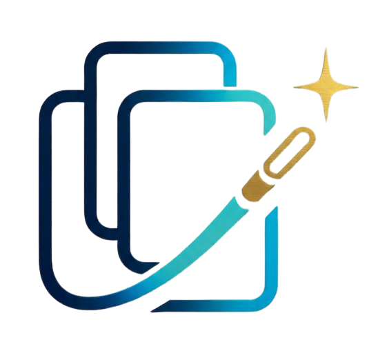

# CopyTyGo

CopyTyGo is a full-stack Go and TypeScript framework for building web applications and APIs.

## Features

- [CLI](https://copytygo.org/docs/v5/cli/) for creating, running, and building applications.
- [Authentication](https://copytygo.org/docs/v5/authentication/) with single-role and multi-role setups.
- [MySQL and PostgreSQL support](https://copytygo.org/docs/v5/database/) with [schema migrations](https://copytygo.org/docs/v5/migration/).
- [Resource generation](https://copytygo.org/docs/v5/resource-generator/) for database-backed CRUD endpoints.
- [Frontend presets](https://copytygo.org/docs/v5/frontend/) for TypeScript, React, Vue, and API-only projects.
- [Background jobs](https://copytygo.org/docs/v5/queue/) and [task scheduling](https://copytygo.org/docs/v5/scheduler/).
- [CopyTyGo Studio](https://copytygo.org/docs/v5/studio/) for local development and inspection.

## Getting started

See the [CopyTyGo v5 documentation](https://copytygo.org/docs/v5/) for an overview. Follow the [installation guide](https://copytygo.org/docs/v5/installation/) to set up the CLI and the [getting started guide](https://copytygo.org/docs/v5/getting-started/) to create your first application.

## Contributing

See the [contribution guide](CONTRIBUTING.md) for reporting issues and submitting pull requests.
